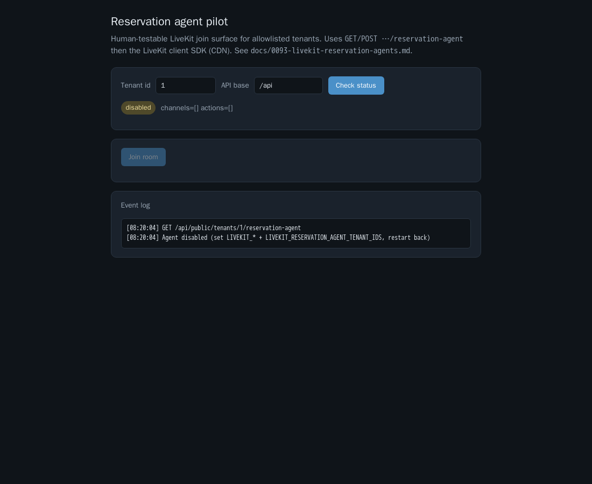

# LiveKit reservation agents (#456 / #457)

> **Status: human-testable pilot.** Voice + chat agent worker talks to **existing** public reservation APIs. No second booking store. Guest join surface: `/reservation-agent-pilot.html`.

## Product decisions (defaults)

| Choice | Value |
|--------|--------|
| **Channels** | Voice **and** chat (issue #456 human reply) |
| **Actions (v1)** | Availability (`next-available`, day slots), **create**, **cancel/lookup by token** |
| **Pilot tenants** | `LIVEKIT_RESERVATION_AGENT_TENANT_IDS` (comma-separated). Empty = public session mint **off** |
| **Architecture** | Thin LiveKit Agents worker → HTTP → POS public reservation routes |

Staff modify/cancel without token stays on the existing authenticated `/reservations` UI.

## What shipped

| Piece | Role |
|-------|------|
| `back/app/reservation_agent_client.py` | HTTP client for public book/cancel APIs |
| `back/app/livekit_reservation.py` | Allowlist + guest LiveKit JWT mint (python-jose) |
| `GET /public/tenants/{id}/reservation-agent` | Enabled? + channels/actions |
| `POST /public/tenants/{id}/reservation-agent/session` | Mint room + guest token (pilot only) |
| `back/livekit_reservation_agent/` | Optional worker (separate requirements) |
| `front/public/reservation-agent-pilot.html` | Minimal guest join UI (LiveKit client via CDN) for human verification (#457) |

## APIs the agent calls

Same contracts as the public book page:

- `GET /reservations/next-available`
- `GET /reservations/book-day-slots`
- `POST /reservations` (body includes `tenant_id`)
- `GET /reservations/by-token`
- `PUT /reservations/{id}/cancel?token=…`

## Config (`config.env`)

Exact keys (never commit real values):

| Key | Required for | Notes |
|-----|--------------|--------|
| `LIVEKIT_URL` | Status enabled + session mint + worker | e.g. `wss://….livekit.cloud` |
| `LIVEKIT_API_KEY` | Same | From LiveKit Cloud (or self-hosted) |
| `LIVEKIT_API_SECRET` | Same | Secret; deployment secrets only |
| `LIVEKIT_RESERVATION_AGENT_TENANT_IDS` | Pilot allowlist | e.g. `1` - empty keeps feature **off** |
| `LIVEKIT_RESERVATION_AGENT_TOKEN_TTL_SECONDS` | Optional | Default `3600` |
| `POS_API_BASE_URL` | Worker only | e.g. `http://127.0.0.1:4202/api` (or host HAProxy port) |
| `LIVEKIT_AGENT_TENANT_ID` | Worker only | Tenant the tools call; default `1` |

```bash
# LIVEKIT_URL=wss://your-project.livekit.cloud
# LIVEKIT_API_KEY=
# LIVEKIT_API_SECRET=
# LIVEKIT_RESERVATION_AGENT_TENANT_IDS=1
# LIVEKIT_RESERVATION_AGENT_TOKEN_TTL_SECONDS=3600
# POS_API_BASE_URL=http://127.0.0.1:4202/api
# LIVEKIT_AGENT_TENANT_ID=1
```

After editing `config.env`, restart **`back`** so settings reload:

```bash
docker compose -f docker-compose.yml -f docker-compose.dev.yml up -d back
```

## Human test (step by step)

### A. Gated checks (no LiveKit Cloud credentials)

These must pass on a normal local stack when `LIVEKIT_*` are unset:

1. Status API returns disabled:

```bash
# Use your HAProxy host port (example: 14202 on some hosts, 4202 on others)
curl -s http://127.0.0.1:14202/api/public/tenants/1/reservation-agent
# {"enabled":false,"channels":[],"actions":[]}
```

2. Session mint is unavailable:

```bash
curl -s -o /dev/null -w "%{http_code}\n" -X POST \
  http://127.0.0.1:14202/api/public/tenants/1/reservation-agent/session
# 404
```

3. Open the pilot page and confirm badge **disabled**:

`http://127.0.0.1:<port>/reservation-agent-pilot.html?tenantId=1`

4. Automated harness (screenshot under `docs/screenshots/`):

```bash
BASE_URL=http://127.0.0.1:14202 npm run test:reservation-agent-pilot --prefix front
```

Screenshot when gated off:



### B. Full pilot (LiveKit Cloud + worker)

1. Set all keys in `config.env` (table above). Keep secrets out of git / task files.
2. Restart `back`. Confirm:

```bash
curl -s http://127.0.0.1:<port>/api/public/tenants/1/reservation-agent
# {"enabled":true,"channels":["voice","chat"],"actions":["availability","create","cancel_by_token"]}
```

3. Start the optional worker (separate venv; do **not** add these deps to the main API image):

```bash
cd back
python -m venv .venv-livekit && source .venv-livekit/bin/activate
pip install -r livekit_reservation_agent/requirements-livekit.txt
# Load LIVEKIT_* , POS_API_BASE_URL, LIVEKIT_AGENT_TENANT_ID from config.env
python -m livekit_reservation_agent dev
```

4. Open `/reservation-agent-pilot.html?tenantId=1` → **Check status** → **Join room**.
5. Enable mic and/or send chat; ask the agent for next available / book / cancel-by-token.
6. Re-run the harness with credentials live (`REQUIRE_ENABLED=1` optional):

```bash
BASE_URL=http://127.0.0.1:<port> REQUIRE_ENABLED=1 \
  npm run test:reservation-agent-pilot --prefix front
```

Expected screenshots when enabled: `livekit-reservation-agent-pilot-enabled.png` and, on successful join, `livekit-reservation-agent-pilot-joined.png`.

## Run the worker (optional)

```bash
# Separate venv recommended (do not add livekit-agents to the main API image)
cd back
python -m venv .venv-livekit && source .venv-livekit/bin/activate
pip install -r livekit_reservation_agent/requirements-livekit.txt
# Load LIVEKIT_* and POS_API_BASE_URL from config.env
python -m livekit_reservation_agent dev
```

The worker registers with LiveKit; when a guest obtains a session token from POS and joins the room, the agent handles voice (STT/TTS) and text chat with the same tools.

## Frontend

Pilot join page (human verification, #457):

1. Open `/reservation-agent-pilot.html?tenantId=<id>`
2. Page calls `GET …/reservation-agent` → if `enabled`
3. **Join room** → `POST …/reservation-agent/session` → `url` + `token` + `room_name`
4. Connects with LiveKit client SDK (CDN) for voice and/or data chat

No full guest marketing widget; this page is intentionally minimal.

## Out of scope (v1)

- SIP telephony trunking
- Staff-authenticated agent tools
- Modify reservation date/time without token
- Bundling `livekit-agents` into `pos-back` Docker image
- Marketing claims beyond this pilot path

## Tests

```bash
docker compose -f docker-compose.yml -f docker-compose.dev.yml exec back \
  python3 -m pytest tests/test_livekit_reservation_agent.py -q

BASE_URL=http://127.0.0.1:14202 npm run test:reservation-agent-pilot --prefix front
```
