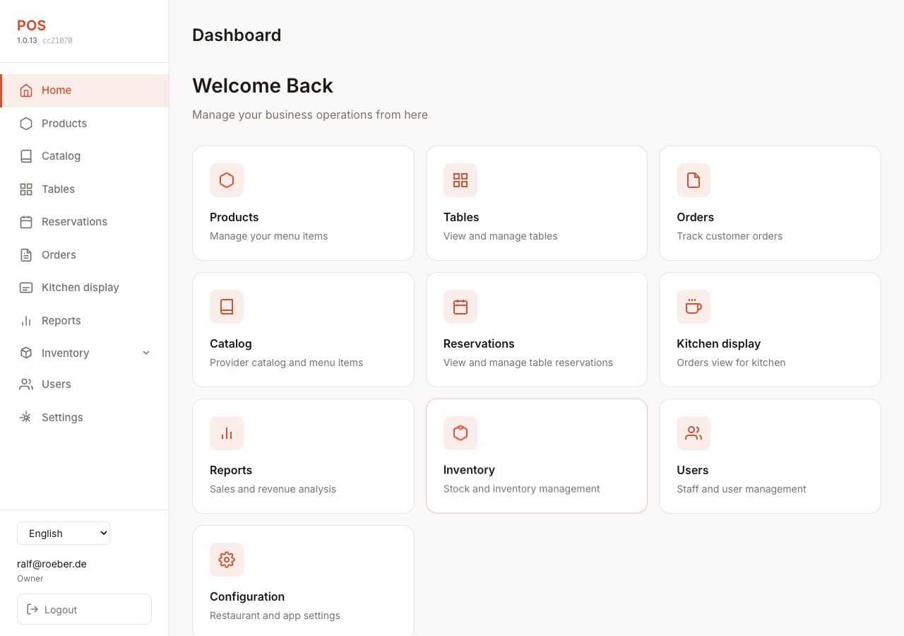
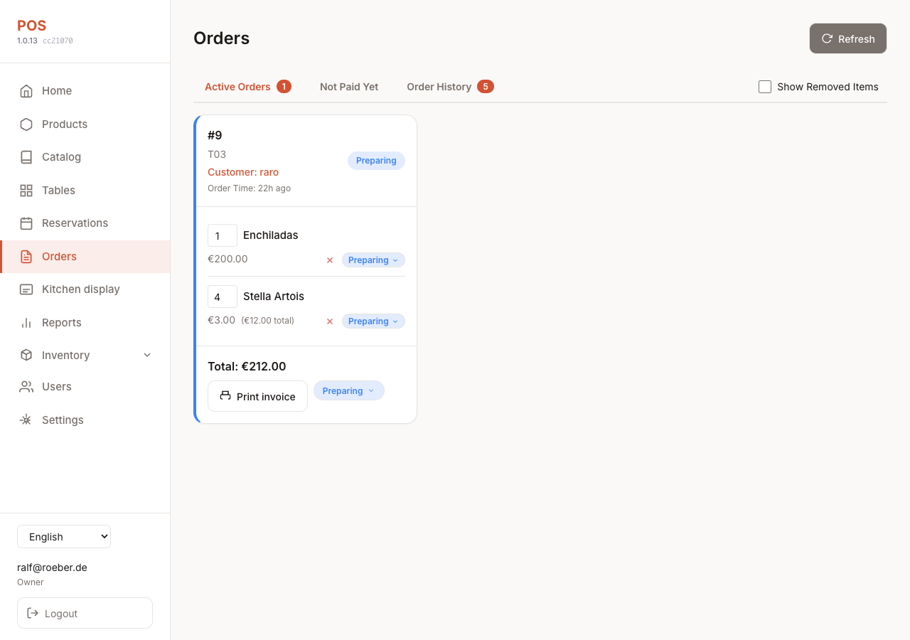
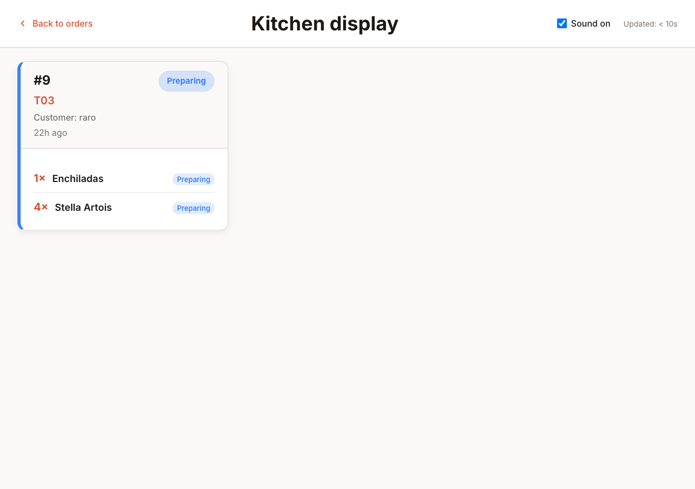
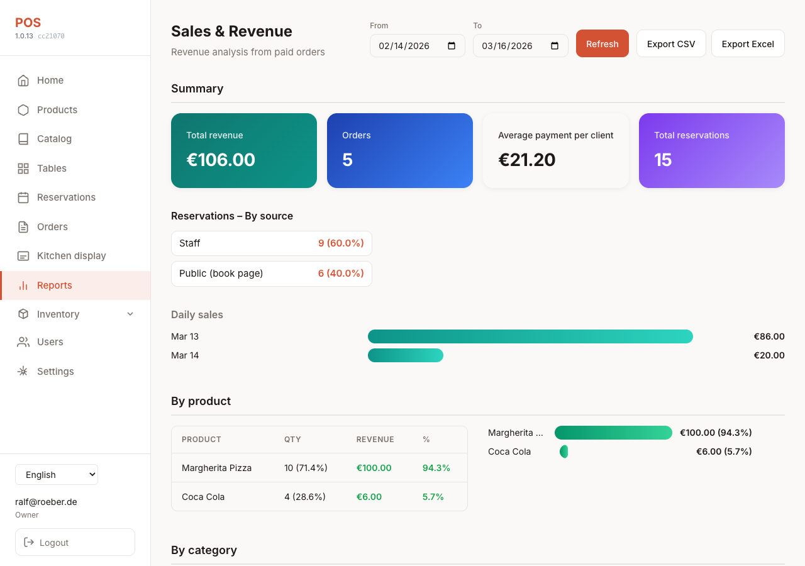
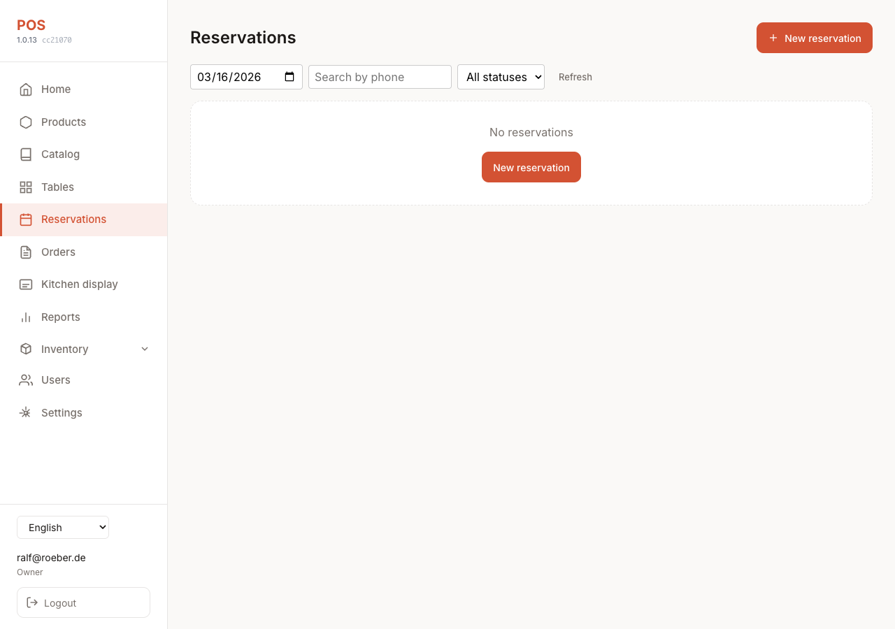
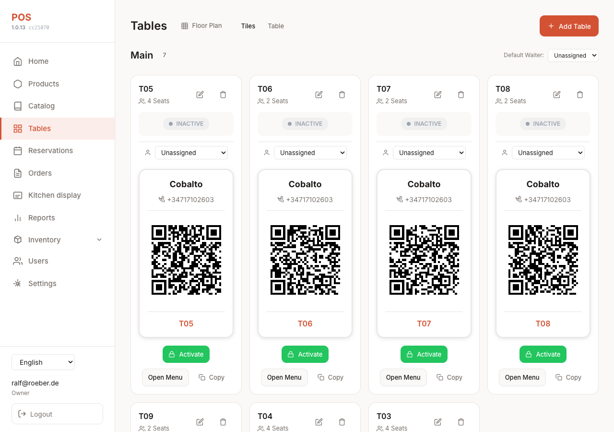
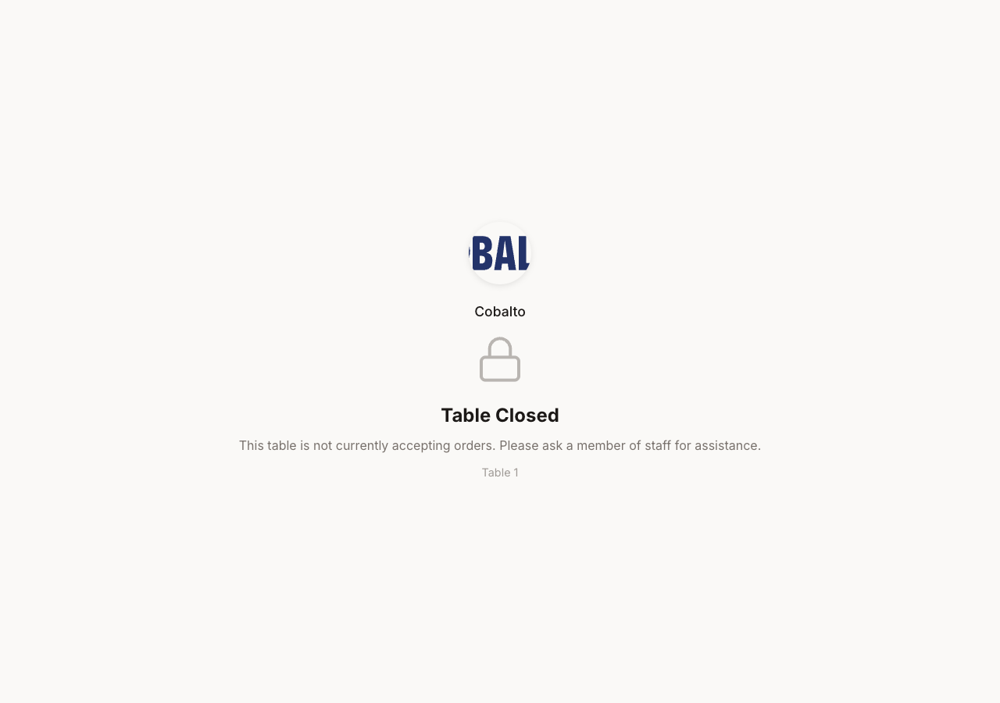
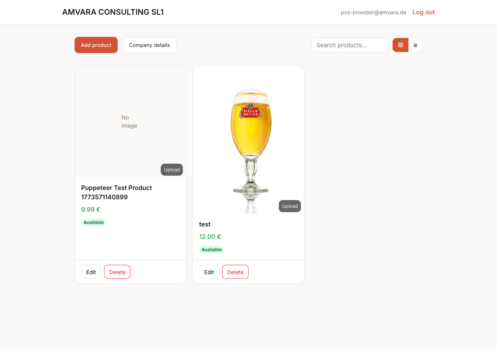

# Screenshots

This folder holds screenshots used in the main [README.md](../../README.md) and in feature docs to give a visual overview of POS2.

## Capturing screenshots automatically

With the app running at `http://127.0.0.1:4202` (or set `BASE_URL`), run:

```bash
# From repo root; uses LOGIN_EMAIL and LOGIN_PASSWORD from .env or environment
LOGIN_EMAIL=owner@amvara.de LOGIN_PASSWORD=secret node front/scripts/capture-screenshots.mjs
# Or: npm run capture-screenshots --prefix front
```

Optional captures (skipped with a clear log line when unset or login fails):

- `PROVIDER_TEST_EMAIL` / `PROVIDER_TEST_PASSWORD` - provider dashboard
- `COURIER_EMAIL` / `COURIER_PASSWORD` (or `COURIER_TEST_*`) - courier portal home
- `PLATFORM_OPERATOR_EMAIL` / `PLATFORM_OPERATOR_PASSWORD` - platform operator dashboard

Public **delivery** and **waitlist** use `TENANT_ID` (default `1`) and need no extra credentials. Runs headless by default; set `HEADLESS=0` to open a visible browser.

## Adding screenshots manually

1. Run the app locally or use a staging instance.
2. Capture the screen (e.g. PNG or WebP, ~1200-1600px wide for readability).
3. Save the file here with the name listed below.
4. Optionally strip or blur sensitive data (tenant name, real emails) if needed.

## Screenshots

### Staff dashboard

Quick links to Catalog, Reservations, Kitchen, Reports, and more. Used in the [main README](../../README.md) screenshot collage.



### Orders

Orders list with order cards, status, items, and actions.



### Kitchen display

Full-screen view for the kitchen. Used in the [main README](../../README.md) screenshot collage. See [docs/0015-kitchen-display.md](../0015-kitchen-display.md).



### Reports (Informes)

Date range, summary cards, by product/category/table/waiter. See [docs/0016-reports.md](../0016-reports.md).



### Reservations

Reservations list and management. See [docs/0011-table-reservation-user-guide.md](../0011-table-reservation-user-guide.md).



### Tables

Tables canvas and floor plan.



### Customer menu

Customer-facing menu at `/menu/{table_token}`: products, cart, place order. Used in the [main README](../../README.md) screenshot collage.



### Provider dashboard

Provider catalog management. See [docs/0014-provider-portal.md](../0014-provider-portal.md).



### Public Satisfecho Delivery

Guest checkout at `/delivery/{tenantId}`. See [docs/0053-satisfecho-delivery-order-channel.md](../0053-satisfecho-delivery-order-channel.md).


### Public waiting list

Walk-in join form at `/waitlist/{tenantId}`. See [docs/0011-table-reservation-user-guide.md](../0011-table-reservation-user-guide.md) (Waiting list).


### Courier portal

Courier home after `/courier/login` (Available / Mine / Completed). See [docs/0053-satisfecho-delivery-order-channel.md](../0053-satisfecho-delivery-order-channel.md).


### Platform operator

Operator dashboard at `/platform`. See [docs/0059-platform-operator-portal.md](../0059-platform-operator-portal.md).


---

## File reference

| File | Where it's used |
|------|------------------|
| `dashboard.png` | Main README (screenshot collage) |
| `orders.png` | - |
| `kitchen.png` | Main README (screenshot collage); docs/0015-kitchen-display.md |
| `reports.png` | docs/0016-reports.md |
| `reservations.png` | docs/0011-table-reservation-user-guide.md |
| `tables.png` | - |
| `menu.png` | Main README (screenshot collage) |
| `provider.png` | docs/0014-provider-portal.md |
| `delivery.png` | docs/0053-satisfecho-delivery-order-channel.md (optional) |
| `waitlist.png` | docs/0011-table-reservation-user-guide.md (optional) |
| `courier.png` | docs/0053-satisfecho-delivery-order-channel.md (optional) |
| `platform.png` | docs/0059-platform-operator-portal.md (optional) |
